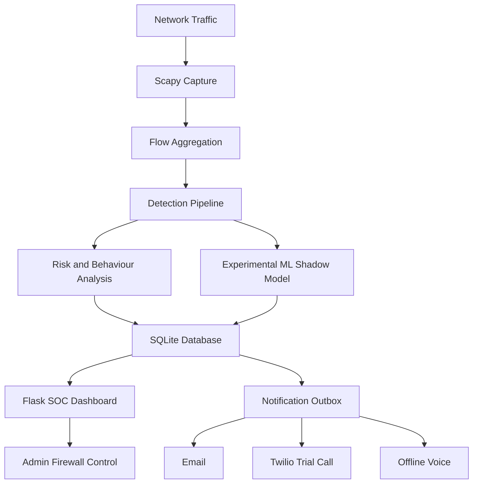

# Cyber Sentinel X

### AI-Assisted Security Operations Platform

A defensive cybersecurity portfolio project developed by Bala Kamalesh for real-time network monitoring, threat detection, incident investigation and controlled security response.


## Features

- Real-time passive packet capture using Scapy.
- Behaviour-based port scan and brute-force detection.
- Authentication monitoring and role-based access control.
- Risk scoring, security alerts and incident correlation.
- Random Forest experimental shadow inference.
- Offline IP geolocation and ASN intelligence.
- Asset inventory and authorized Nmap host discovery.
- Gmail security notifications.
- Twilio trial phone-call escalation.
- Free offline spoken threat alerts using eSpeak NG.
- Administrator-controlled nftables firewall response.
- PCAP analysis and CSV report exports.
- Live SOC dashboard and single-command startup.

## Architecture



## Technology Stack

| Component | Technology |
|---|---|
| Backend | Python, Flask |
| Database | SQLite |
| Network monitoring | Scapy |
| Machine learning | scikit-learn, Random Forest |
| Asset discovery | Nmap |
| Geolocation | DB-IP City Lite and ASN Lite |
| Response | nftables |
| Notifications | SMTP, Twilio, eSpeak NG |
| Frontend | HTML, CSS, JavaScript |

## Installation

Run inside the project directory on Kali Linux.

```bash
apt install python3-venv nmap nftables espeak-ng
python3 -m venv .venv
.venv/bin/python -m pip install -r requirements.txt
```

For a fresh installation only, copy `.env.example` to `.env`.
Set a strong persistent `CYBER_SENTINEL_SECRET` and keep the file private.

Create the initial administrator:

```bash
.venv/bin/python -c 'from getpass import getpass; from backend.database.schema import initialize_database; from backend.security.auth_service import auth_service; initialize_database(); auth_service.initialize(); auth_service.create_user(input("Admin username: "), getpass("Password: "), role="ADMIN")'
```

## Start the Platform

```bash
./start_csx.sh
```

Open http://127.0.0.1:8000 in the Kali browser.

The launcher starts the dashboard, packet capture and notification worker.
Packet capture requires appropriate operating-system permissions.

Press Ctrl+C in the launcher terminal to stop the services.

## Machine Learning Evaluation

Experimental Random Forest evaluation using the UNSW-NB15 dataset:

| Metric | Result |
|---|---:|
| Test samples | 72,513 |
| Accuracy | 88.37% |
| Attack recall | 89.44% |
| False-positive rate | 12.71% |
| ROC AUC | 0.9657 |
| Operating threshold | 0.65955 |

The model uses TCP/UDP flow features and runs in observational shadow mode.
Its predictions do not control production risk scores or alerts.
The active detector remains the statistical baseline.
Generated model artifacts are not included in the public repository.

## Notifications

- HIGH and CRITICAL: email and offline spoken alerts when configured.
- CRITICAL: optional Twilio phone call.
- Limited Twilio trial accounts play a provider sample message.
- Offline voice announces the actual security alert details without API charges.
- Duplicate source/severity/channel notifications are suppressed for 15 minutes.

Provider acceptance does not guarantee that a recipient received or answered a notification.

## GeoIP Intelligence

Optional local DB-IP City Lite and ASN Lite MMDB databases provide approximate
public-IP location and organization information. Place them under `data/geoip/`
or configure `CSX_GEOIP_CITY_DB` and `CSX_GEOIP_ASN_DB`.

IP geolocation data provided by [DB-IP](https://db-ip.com/).
Location results are approximate and do not establish an attacker identity.

## Automated Tests

```bash
CSX_EMAIL_ENABLED=0 CSX_VOICE_ENABLED=0 CSX_LOCAL_VOICE_ENABLED=0 \
.venv/bin/python -m unittest discover -s tests -q
```

Latest verified result: **41 tests passed, zero unclosed SQLite database warnings.**

## Security and Limitations

- Educational defensive SOC prototype, not a production SIEM.
- Use only on networks you own or have authorization to monitor.
- Firewall execution is disabled by default; testing uses mocked operations.
- Keep the dashboard on localhost in an authorized lab environment.
- Never commit credentials, live databases, PCAP files or sensitive logs.
- Observed traffic and risk scores are not proof of a real attack.
- Optional models must be loaded only from trusted sources.
- Public repository excludes private runtime data and generated binary artifacts.

## Author

**Bala Kamalesh**

B.Tech Computer Science Engineering — Cybersecurity

Developed as a hands-on cybersecurity and SOC engineering portfolio project.
